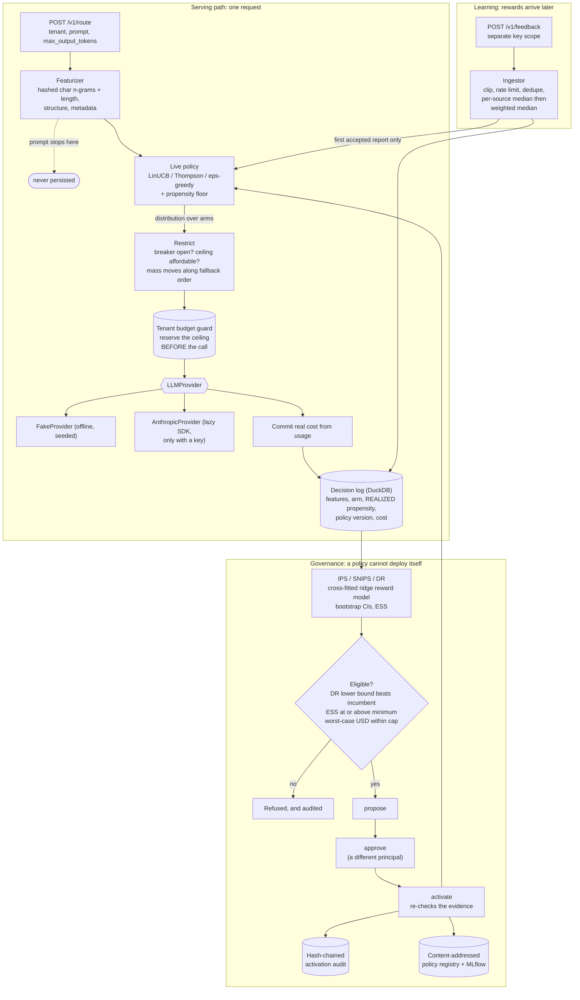

# bandit-llm-router

Contextual-bandit routing across Claude Haiku, Sonnet and Opus that learns the cost-quality
trade-off from feedback, logs propensities, and must beat the incumbent in off-policy evaluation
before any new policy ships.

## The problem

Sending every request to the largest model wastes money. Static routing rules ("prompts with a code
fence go to Opus") miss per-request difficulty and drift out of date the moment a model is updated.
And A/B testing each routing idea is slow and risky, because the experiment is the exposure.

This repo treats model selection as a **learned decision policy** rather than a configuration value,
and it takes the consequences seriously:

1. **Decisions are randomized and logged with their propensities.** The router returns a
   distribution over arms, samples from it, and writes the probability with which the action was
   *actually* taken -- after the circuit breaker and the budget guard have had their say. Without
   that number, everything downstream is guesswork.
2. **Candidate policies are evaluated counterfactually, on logs, before exposure.** IPS, SNIPS and a
   doubly robust estimator with bootstrap confidence intervals estimate what a policy the log never
   ran *would have* earned.
3. **Promotion is a gate, not a deploy.** A candidate becomes eligible only if its DR lower
   confidence bound beats the incumbent's estimate, its effective sample size clears a minimum, and
   its worst-case exploration cost fits a budget. Then a second principal has to approve it, and the
   activation is hash-chain audited.

Everything runs offline on a CPU. The simulator and a seeded fake provider make routing, learning,
OPE and the whole governance path reproducible with no API key and no network.

## Architecture



Three details carry most of the weight:

- **The propensity that is logged is the one that ran.** Arms blocked by an open breaker or by a
  budget ceiling are zeroed and their probability mass moves to the first affordable, healthy arm;
  a post-failure redirect logs its adjusted propensity and flags the row. Logging the policy's
  *intended* distribution instead would bias every later estimate, permanently (ADR 0005).
- **Exploration is priced before it happens.** The budget guard admits a call only if the arm's cost
  ceiling still fits the tenant's remaining cap, so `spent <= cap` is an invariant, and an arm the
  policy wants is simply unavailable rather than overdrawn. Screening applies the same idea over a
  horizon: a candidate whose worst case busts a budget is refused however good it looks.
- **Thompson sampling is deployed as its Monte-Carlo action distribution**, because a sampled argmax
  has no closed-form propensity and logging it as certain would silently invalidate the log
  (ADR 0003).

Layout:

```text
src/bandit_llm_router/
  simulator/     workload families, per-arm quality model, scheduled shifts
  policies/      discounted ridge posteriors; LinUCB, Thompson, eps-greedy, static, keyword rule
  ope/           IPS / SNIPS / DR estimators, bootstrap CIs, ESS; the screening gate
  features.py  reward.py  arms.py  budgets.py  breaker.py  feedback.py  logstore.py
  activation.py  service.py  experiments.py  monitoring.py  demo.py
  core/          settings, redacting logs, tracing, metrics, hardened app   ml/  agentic/
bench/  4 benches + thresholds.json      tests/unit, tests/integration
docs/THREAT_MODEL.md  docs/adr/  CLAIMS.md  MODEL_CARD.md
```

## Quickstart

Requirements: [uv](https://docs.astral.sh/uv/) and Python 3.12. No API key needed.

```bash
uv sync --frozen
uv run python tasks.py demo    # one simulated day, end to end, offline (~45s)
uv run python tasks.py check   # ruff, mypy --strict, pytest + coverage, bandit, pip-audit, baseline
uv run python tasks.py bench   # all four benches against bench/thresholds.json (~8 min)
```

On Windows, or any machine where the repo drive is small, keep the environment elsewhere:
`$env:UV_PROJECT_ENVIRONMENT = "C:/Users/<you>/.venvs/bandit-llm-router"`.

`tasks.py` is the single source of truth; the `Makefile` delegates to it so Linux and CI agree with
Windows. Targets: `lint format typecheck test bench demo bandit pip-audit audit baseline check`.

The demo prints seven sections: policies over one request stream, a mid-day quality shift, OPE
against the simulator's exact values, screening and activation (with the true values next to the
gate's verdicts), hostile feedback, the live service path on DuckDB, and an MLflow run.

Run the service:

```bash
uv run bandit-llm-router generate-api-key --scope route      # and again per scope
APP_ROUTE_API_KEY_SHA256=<digest> APP_FEEDBACK_API_KEY_SHA256=<digest> \
APP_ADMIN_API_KEY_SHA256=<digest> APP_APPROVER_API_KEY_SHA256=<digest> \
  uv run bandit-llm-router serve

curl -s -H "X-API-Key: <route key>" -H "Content-Type: application/json" \
  -d '{"tenant_id": "acme", "prompt": "Summarize these release notes in three bullets.",
       "max_output_tokens": 400}' \
  http://127.0.0.1:8000/v1/route
```

With no `ANTHROPIC_API_KEY` the arms are served by the offline provider, which reports token counts
scaled to each arm's own estimate -- so budgets, costs and metrics exercise realistic numbers with no
spend. Set the key to route to the real models.

Verify an activation chain: `uv run bandit-llm-router audit verify var/demo/service/activations.audit.jsonl`.

Containers: `docker compose up --build` runs the non-root, read-only image with a writable volume for
the decision log and audit chain. Image build, smoke test, hadolint, trivy and the SBOM run in CI
(`.github/workflows/ci.yml`, job `docker`); docker was **not** run locally while building this repo.

## Results

Every number below was copied from one `uv run python tasks.py bench` run on 2026-09-28, which runs
all four benches shown; each also runs standalone by the command given under its heading. Machine:
Windows 10 (10.0.19045), Intel64 Family 6 Model 158 (6 logical CPUs), Python 3.12.14, CPU only, no
API key. Each bench enforces its own section of `bench/thresholds.json` and every one printed
"all ... within thresholds". CI runs the same commands (jobs `bench` and `evaluation`).

The simulations are seeded, so the reward, cost, regret, OPE and robustness figures reproduce exactly
on a rerun; only the timings move.

### Learning and cost, 200,000 simulated requests

`uv run python bench/bench_regret.py --check` (114.4s). All policies see the *same* request stream.
`in_class_slope` is the fitted log-log slope of regret against the best policy the linear model class
can represent; below 1 means sublinear, so the learner is still closing the gap.

| policy | mean reward | mean quality | USD / 1k req | saving vs Sonnet | saving vs Opus | quality delta vs Sonnet | in-class regret | in-class slope | arm shares (h/s/o) |
|---|---:|---:|---:|---:|---:|---:|---:|---:|---|
| **linucb** | 0.6508 | 0.7556 | 2.952 | **36.5%** | 77.9% | +0.0048 | 468.0 | **0.766** | 0.82 / 0.10 / 0.07 |
| **thompson** | 0.6497 | 0.7506 | 2.840 | **38.9%** | 78.8% | -0.0003 | 702.2 | **0.598** | 0.83 / 0.10 / 0.07 |
| epsilon_greedy | 0.6454 | 0.7503 | 2.955 | 36.4% | 77.9% | -0.0006 | 1541.8 | 0.938 | 0.82 / 0.10 / 0.07 |
| keyword_rule | 0.6235 | 0.7782 | 4.338 | 6.7% | 67.6% | +0.0273 | 6797.3 | 0.996 | 0.59 / 0.26 / 0.15 |
| always haiku | 0.6416 | 0.7144 | 2.053 | 55.8% | 84.6% | -0.0365 | 2299.5 | 1.004 | -- |
| always sonnet | 0.5851 | 0.7509 | 4.648 | 0 | 65.2% | 0 | 14498.1 | 0.998 | -- |
| always opus | 0.4048 | 0.8730 | 13.375 | -187.7% | 0 | +0.1221 | 50032.2 | 0.999 | -- |

LinUCB and Thompson both clear the target of a **30% cost reduction against always-Sonnet at mean
quality within 1 percentage point** (+0.48pp and -0.03pp). Always-Haiku is cheaper still, and *that
is the honest comparison the table exists to make*: it buys its saving with a 3.7pp quality drop,
which is why it loses on the cost-penalized reward. The hand-written keyword rule saves almost
nothing. The static baselines' slopes sit at ~1.0, i.e. their regret grows linearly, as it must.

On a **well-specified** linear problem (60,000 requests), where the model class contains the truth,
the slopes separate cleanly:

| policy | regret | regret slope |
|---|---:|---:|
| linucb | 10.3 | 0.094 |
| thompson | 43.8 | 0.163 |
| epsilon_greedy | 311.6 | 0.876 |
| static arm | 7258.3 | 0.996 |

### Off-policy evaluation accuracy, 40,000 logged rows

`uv run python bench/bench_ope.py --check` (153.7s). Estimates are scored against the simulator's
*exact* policy values, over 60 trials (15 seeds x 4 candidates), at two logging propensity floors.

| logging floor | estimator | bias | RMSE | 95% CI coverage | mean ESS |
|---|---|---:|---:|---:|---:|
| 0.05 | ips | -0.0004 | 0.0036 | 0.983 | 15345.6 |
| 0.05 | snips | +0.0001 | 0.0022 | 0.950 | 15345.6 |
| 0.05 | **dr** | -0.0001 | **0.0007** | 1.000 | 15345.6 |
| 0.01 | ips | -0.0009 | 0.0059 | 0.967 | 9857.2 |
| 0.01 | snips | -0.0002 | 0.0035 | 0.933 | 9857.2 |
| 0.01 | **dr** | -0.0003 | **0.0011** | 0.983 | 9857.2 |

DR is 5x more accurate than IPS by RMSE, and the ordering holds when the logging floor is dropped to
0.01, where importance weights get large. **Coverage is conservative, not calibrated**: DR's bootstrap
intervals cover the truth 98.3-100% of the time against a nominal 95%. That is safe for a promotion
gate -- an over-wide interval refuses candidates it should not admit rather than admitting ones it
should not -- but it is not the `[0.90, 0.98]` band the project spec asked for, and it means the gate
is *stricter* than 95% nominal implies. SNIPS (0.950, 0.933) is the well-calibrated one. See
Non-goals.

What the gate did with those estimates, swept over candidate quality:

| sweep | truly worse candidates | rejected | truly better candidates | admitted |
|---|---:|---:|---:|---:|
| vs a converged incumbent | 9 | **9 (100%)** | 0 | -- |
| vs a stale cost-blind incumbent | 0 | -- | 9 | **9 (100%)** |

### Adaptation after a mid-run model update, 120,000 requests

`uv run python bench/bench_router.py --check` (151.5s). At one third of the run, Haiku -- which
carries ~82% of the traffic -- degrades on every prompt family. "Recover" means getting the trailing
reward ratio back to 95% of oracle.

| posterior | discount | pre-shift ratio | trough ratio | requests to recover | final ratio |
|---|---:|---:|---:|---|---:|
| stationary | 1.0 | 0.9969 | **0.5755** | 19,851 | 0.9973 |
| discounted | 0.999 | 0.9895 | 0.9766 | **never fell below target** | 0.9980 |
| discounted | 0.9995 | 0.9928 | 0.9684 | **never fell below target** | 0.9982 |

The stationary posterior loses 42 points of reward ratio and takes ~20k requests to climb back,
because its confidence widths had collapsed exactly where the evidence went stale. Both discounted
posteriors absorb the same shift without ever dropping below the target -- so the honest reading of
this table is "19,851 versus never dipped", not two recovery counts (ADR 0004). The bench enforces
that the stationary policy really is hurt, so this comparison cannot quietly become vacuous.

### Robustness to feedback poisoning, 40,000 requests

10% of decisions receive hostile reward reports, replayed identically with the defenses off, half on,
and fully on.

| feedback | defenses | mean decision value | value drop |
|---|---|---:|---:|
| honest only | -- | 0.6495 | 0 |
| 10% adversarial | none | 0.4168 | **0.2327** |
| 10% adversarial | clipping only | 0.6493 | 0.0002 |
| 10% adversarial | full pipeline | 0.6494 | 0.0001 |

Undefended, a tenth of the feedback destroys 36% of the policy's value -- roughly the difference
between a learned router and always-Opus. Clipping alone recovers almost all of it, which is the
honest finding: **bounding the reward range is where nearly all of the benefit is**, and the robust
aggregation earns the remaining 0.0001 plus protection against attacks clipping cannot see (many
reports inside the valid range). The defenses do not survive a hostile *majority* of sources; that
limit is tested explicitly and documented in the threat model.

### Routing overhead, 2,000 requests through the live path

Featurize, decide, restrict, reserve, call the offline provider, commit, log to DuckDB. Reported
twice because the shared budget file dominates one of the numbers (ADR 0006); both configurations
logged all 2,000 decisions.

| budget guard | p50 (us) | p95 (us) | p99 (us) |
|---|---:|---:|---:|
| shared budget file (default) | 25,348 | 34,519 | 47,807 |
| in-memory guard | 6,092 | 12,129 | 29,459 |

The shared file costs ~19ms per request at p50: two atomic writes plus a reload under a file lock,
per reserve and per commit, so several workers draw from one cap. That is a deliberate trade of
latency for a correct multi-worker budget, and it is disk-bound on this machine.

### Core micro-benchmarks

`uv run python bench/bench_baseline.py --check`.

| benchmark | runs | p50 (us) | p95 (us) |
|---|---:|---:|---:|
| redact_text_1kb | 2000 | 342.0 | 452.0 |
| rate_limiter_check | 20000 | 1.8 | 2.1 |
| llm_request_sha256_10_messages | 2000 | 98.5 | 166.2 |
| audit_append_fsync | 200 | 7981.4 | 11618.1 |
| audit_verify_1000_entries | 10 | 35180.9 | 37543.3 |
| drift_check_10k_vs_10k | 30 | 2632.2 | 3101.3 |

`audit_append_fsync` includes one `fsync` per entry, so it mostly measures the disk. These are
single-machine numbers for spotting regressions, not performance claims.

### Test suite

`uv run python tasks.py test`: **763 passed, 1 skipped** in 273s, line+branch coverage **97.9%**
(floor 85%).
Property-based tests (hypothesis) cover the invariants that matter: propensities sum to 1 and respect
their floor; the reward stays in [0, 1] for every cost weight; committed spend never exceeds a cap
over random reserve/commit/release sequences.

## Security

Threats, controls and the tests that prove them: [docs/THREAT_MODEL.md](docs/THREAT_MODEL.md). Every
claim above maps to evidence in [CLAIMS.md](CLAIMS.md). Reporting: [SECURITY.md](SECURITY.md).

Two threats are specific to a router that learns from the outside world, and they get most of the
attention:

- **Reward poisoning.** Whoever can post feedback can steer which model gets traffic and what it
  costs. Reports are clipped into the reward range and counted, rate limited per key, capped per
  decision and per source, deduplicated by `report_id`, and combined with a per-source median
  followed by a weighted median whose weights are capped *strictly* below one half (a cap of exactly
  one half is refused, because the weighted median would then be owned by whoever reaches half the
  weight first). A single-source reward learns with reduced weight. The measured worth of all this is
  the table above. **A hostile majority of sources wins** -- tested and stated, not hidden.
- **Cost exhaustion.** Per-tenant USD caps are enforced *before* the provider call, against the arm's
  worst-case cost, so `spent <= cap` is a property rather than a hope; a failed call refunds its
  reservation. Screening bounds exploration over a horizon the same way.

The rest:

- **Four key scopes** -- route, feedback, admin, approve -- held as SHA-256 digests and compared
  against every digest with no early exit. Separation of duties in the activation gate is only
  meaningful if these are different keys, so they are separate settings.
- **Prompts are never persisted.** They reach the featurizer and stop. The log's schema has no column
  that can hold text, the store refuses to open against a prompt-shaped column, and the only
  prompt-derived value stored is a keyed BLAKE2b digest whose key makes digests non-enumerable.
- **Pinned model allowlist.** Arms come from `config/pricing.toml`, whose models must be on the
  allowlist in `arms.py` and whose prices must agree with the table that charges the budget. Adding a
  model is a code review, not a config push.
- **Provider key from the environment only, never logged.** One test drives routing, feedback and
  governance with sentinel provider, digest and API keys configured, captures the real configured log
  stream, and asserts no sentinel appears in it. gitleaks and semgrep run in CI.
- **Activation requires evidence plus a second principal.** Screening runs on the service's own logs
  (the caller cannot supply them), a report is hash-bound to its candidate *and* its log batch, the
  proposer cannot approve their own activation, approvals and activations cannot be replayed, and
  every step -- refusals included -- is appended to a hash-chained audit log.
- **Artifacts are pickle-free**; the registry verifies content hashes on load.
- **CI:** ruff, mypy --strict, pytest with an 85% coverage floor, bandit, semgrep with repo rules,
  pip-audit, gitleaks, hadolint, trivy image scan, syft CycloneDX SBOM, the baseline check, and all
  four benches against their thresholds. Base images are pinned by digest.

## Non-goals

Honest scope limits, not a wish list.

- **Real quality measurement.** Offline `quality` is a simulator proxy with a written-down functional
  form. Every number above validates the learning, evaluation and governance machinery; none of them
  is evidence about a real quality/price frontier. See [MODEL_CARD.md](MODEL_CARD.md).
- **Calibrated DR intervals.** DR's bootstrap coverage measures 0.983-1.000 against a nominal 0.95 --
  conservative, outside the `[0.90, 0.98]` band originally targeted. The gate is therefore stricter
  than nominal, which is the safe direction, but tightening the interval (studentized or BCa
  bootstrap) is not done here. SNIPS is the calibrated estimator if you need one.
- **Traffic-splitting rollout.** The gate promotes a policy atomically. Progressive exposure,
  shadow traffic and automated rollback are out of scope; the breaker and the budget caps are what
  bound the damage of a bad activation.
- **A non-stationary regret bound.** The discounted posterior is a simplified form of the weighted
  linear bandit (ADR 0004) without the second matrix its confidence bound needs, so the adaptation
  claim is measured behaviour on a simulator whose shift we wrote, not a proved bound.
- **Reward-model-free evaluation.** DR's reward model is a cross-fitted ridge regression. A
  misspecified reward model shows up as variance, not bias, only because the propensities are right;
  both being wrong is not something OPE can detect.
- **Unobserved confounding.** Every OPE guarantee assumes the logged features contain everything that
  influenced both the action and the reward. Deployed behind another router that already selects on
  hidden information, this breaks silently.
- **Feature-gaming defenses.** A caller who knows the featurizer can pad a trivial prompt so it looks
  hard and get the expensive arm. The cost lands on their own tenant budget, and per-tenant spend and
  arm-share metrics would reveal it, but nothing here detects it.
- **Distributed anything.** Rate-limit buckets, the breaker and the budget guard coordinate through
  local file locks and in-process state. Multi-replica deployments need a shared store; a network
  filesystem is not one.
- **Tamper-proof audit.** The activation log is tamper-*evident*. Someone with write access to the
  data directory can rebuild the chain; publish the head hash elsewhere. The budget file and the
  activation store are hashed and locked, not signed.
- **User identity and key rotation.** One API-key scheme with four scopes. JWT/OIDC, expiry and
  rotation are not implemented.
- **Complete PII detection.** Redaction is pattern-based and misses names, postal addresses and
  free-form identifiers. Hashed n-gram features are not prompt text, but they are derived from it --
  treat the feature matrix as sensitive.
- **Live model evaluation.** Tests, demo and benches never call a paid API. `AnthropicProvider` is
  tested against a mocked client, and no cassettes ship.
- **An MLflow server.** Runs are logged to the local file backend; the policy registry is a local
  content-addressed store.

## License

MIT. Copyright (c) 2026 Rouviere German.
