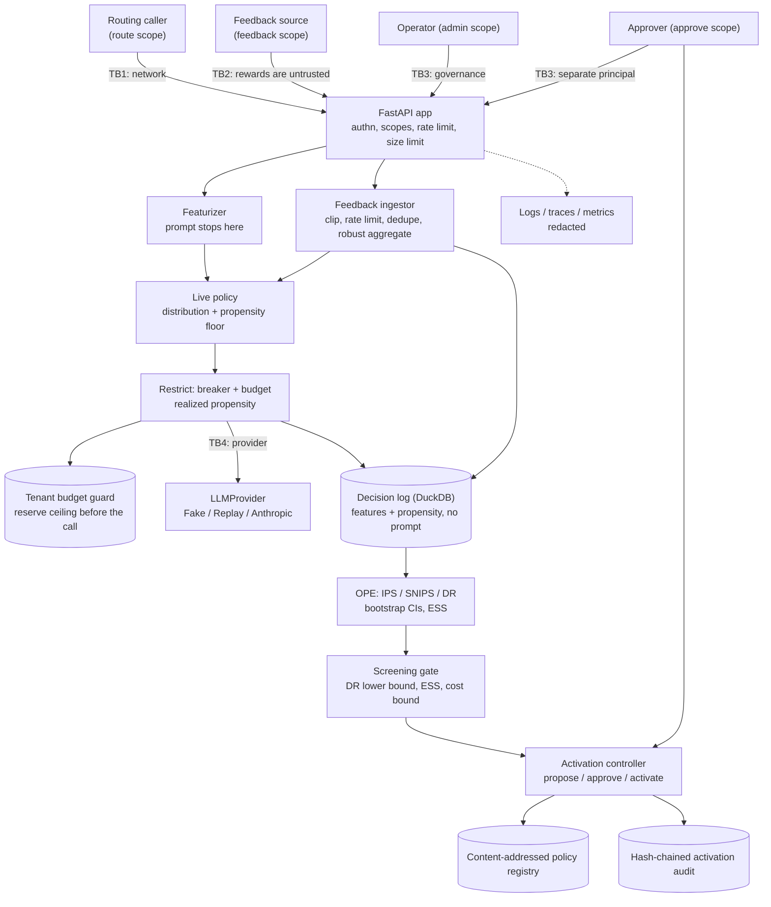

# Threat model: bandit-llm-router

Method: STRIDE per trust boundary. Each row maps a threat to the control that addresses it and to the
test, bench script or CI job that proves the control works. `scripts/check_baseline.py` verifies that
every backticked evidence reference resolves to a real test function, file or CI job.

What makes this system's threat model different from a normal HTTP service: **the router learns from
input it does not control, and the thing it learns decides how money is spent.** Two assets are
therefore unusual and get most of the attention below.

- **The reward signal.** Whoever can post feedback can steer which model receives traffic and what it
  costs. Reward poisoning is the headline threat (T1, T2, D2), and the defenses are measured rather
  than asserted: `bench/bench_router.py` replays the same poisoned stream with them on and off.
- **The propensity log.** Every off-policy estimate, every screening decision and every activation
  rests on the logged propensity being the probability with which the action was *actually* taken. A
  mislabelled log is not noisy, it is biased, and no amount of data repairs it. Corrupting or
  degenerating the log (T3, T4, D4) is an attack on the governance gate itself, one whose damage shows
  up only later as a bad policy that passed its gate.

## System and trust boundaries

**Assets.** The provider API key; the four scoped service keys; the featurizer digest key; tenant
spend; the integrity of the decision log (features, actions, propensities, rewards); the integrity of
the reward signal; the activation audit chain; the policy snapshots in the registry; and the prompts
themselves, which the system is built not to retain.

**Assumptions.** TLS terminates in front of the service. The host, the container runtime and the local
filesystem are trusted. Principals are the API-key identities the router verifies; separation of
duties between `admin` and `approve` is only meaningful if those keys are held by different people.
Feedback sources are named by the caller, so "a source" is at best as trustworthy as the key that
reports it.

## STRIDE table

| ID | STRIDE | Threat | Entry point / asset | Control | Test / evidence | Residual risk |
|---|---|---|---|---|---|---|
| S1 | Spoofing | Caller guesses, replays or brute-forces a service key | TB1, protected routes | Keys held only as SHA-256 digests; a presented key is compared against every configured digest with no early exit; fail closed with none configured; uniform 401 with a challenge | `tests/unit/test_security.py::test_every_configured_digest_is_compared_without_early_exit`, `tests/unit/test_auth.py::test_the_verifier_fails_closed_with_nothing_configured`, `tests/unit/test_auth.py::test_a_missing_key_is_a_401_with_a_challenge` | No expiry or rotation workflow; per-user identity (JWT, OIDC) is out of scope |
| S2 | Spoofing | A routing key posts feedback, or a feedback key proposes a policy -- one credential doing every job | TB1/TB2/TB3, scopes | Four independent key lists (`route`, `feedback`, `admin`, `approve`); a key carries only the scopes it is listed under; scope mismatch is 403, not 401 | `tests/unit/test_auth.py::test_each_key_carries_only_its_own_scope`, `tests/unit/test_auth.py::test_the_route_and_feedback_scopes_cannot_substitute_for_each_other`, `tests/integration/test_router_api.py::test_feedback_needs_the_feedback_scope`, `tests/integration/test_router_api.py::test_the_admin_routes_need_their_own_scopes` | Scope separation is only as real as the operational discipline of keeping the keys apart |
| S3 | Spoofing | An attacker invents a feedback `source` name to look like several independent raters | TB2, reward signal | Reports are attributed per source and per key; one source is reduced to its own median before sources are combined, and per-source report counts are capped, so inventing names buys volume but not weight beyond the weight cap | `tests/unit/test_feedback.py::test_one_source_cannot_outvote_the_others_by_repetition`, `tests/unit/test_feedback.py::test_repetition_does_not_buy_an_attacker_influence`, `tests/unit/test_feedback.py::test_a_source_weight_cap_stops_one_source_owning_the_vote` | A single key can still present as several sources; binding source identity to the key is deployment-specific. See T2 |
| T1 | Tampering | Reward poisoning by extreme values: one report of `1e9` wrecks a ridge posterior | TB2, reward signal, policy | Every report is clipped into the configured reward range before it can reach the posterior, and clipped reports are counted; absurd values are refused by the request schema first | `tests/unit/test_feedback.py::test_an_unbounded_report_is_clipped_and_counted`, `tests/unit/test_feedback.py::test_an_absurd_report_is_refused_by_the_request_schema`, `tests/integration/test_router_api.py::test_a_hostile_reward_is_clipped_before_it_reaches_the_posterior` | Clipping bounds the damage per report, not the direction: an attacker reporting plausible-but-wrong values inside the range is not detected |
| T2 | Tampering | Reward poisoning by volume or by a hostile minority of sources | TB2, reward signal | Per-source median, then a weighted median across sources with weights capped strictly below one half (a cap of exactly one half is refused, because the lower weighted median would then be owned by whoever reaches half the weight first); a decision accepts a bounded number of reports overall and per source; single-source rewards learn with reduced weight | `tests/unit/test_feedback.py::test_one_hostile_source_cannot_move_the_median_outside_the_honest_range`, `tests/unit/test_feedback.py::test_a_cap_of_exactly_one_half_is_refused`, `tests/unit/test_feedback.py::test_a_decision_accepts_only_so_many_reports`, `tests/unit/test_feedback.py::test_corroboration_buys_learning_weight`, `bench/bench_router.py` | Three limits, all asserted rather than implied. (a) **A majority of hostile sources wins**, by design of the median (`tests/unit/test_feedback.py::test_a_majority_attacker_wins_and_the_docs_say_so`). (b) At exactly **two** sources the *lower* report wins, because two weights renormalise to `[0.5, 0.5]` and the lower weighted median lands on the first sorted value -- so a **suppression** attacker reporting `reward_min` beats one honest source while an inflation attacker does not. The minimum-independent-sources requirement is therefore **three**, not two (`tests/unit/test_feedback.py::test_with_two_sources_the_lower_report_wins_so_suppression_beats_inflation`). (c) None of this reaches the **online posterior**: the live policy learns from the first accepted report only, so clipping and the reduced single-source weight are its only defenses, and `bench/bench_router.py` publishes that channel's value drop next to the full pipeline's |
| T3 | Tampering | A replayed or duplicated feedback batch double-counts one outcome, or feedback arrives for a decision that never happened | TB2, decision log | A `report_id` is accepted once (retries are idempotent, not additive); a report is accepted only for a decision that exists and is inside the feedback TTL; anonymous reports are refused | `tests/unit/test_feedback.py::test_a_replayed_report_id_is_idempotent_not_double_counted`, `tests/unit/test_feedback.py::test_feedback_for_an_unknown_decision_is_refused`, `tests/unit/test_feedback.py::test_feedback_outside_the_window_is_refused`, `tests/integration/test_router_api.py::test_a_replayed_report_is_refused` | Dedupe state lives with the decision log; a restored-from-backup log could accept a replay of reports recorded after the backup |
| T4 | Tampering | The logged propensity does not match the mechanism that chose the action, silently biasing every later estimate | Decision log, OPE | The propensity written is the one of the *realized* distribution: arms blocked by the breaker or by the budget are zeroed and their mass moved along the catalog's fallback order; a post-failure redirect is logged with its adjusted propensity and flagged; rows that cannot be reweighted are refused at the contract boundary; the minimum realized propensity is a gauge | `tests/unit/test_breaker.py::test_the_logged_propensity_is_the_realized_one_not_the_policys`, `tests/unit/test_breaker.py::test_a_breaker_adjusted_row_is_still_a_usable_log_row`, `tests/integration/test_router_api.py::test_an_unaffordable_arm_is_dropped_and_the_realized_propensity_is_logged`, `tests/integration/test_router_api.py::test_a_provider_failure_is_redirected_and_the_new_propensity_is_logged`, `tests/unit/test_ope.py::test_a_batch_refuses_rows_that_cannot_be_reweighted` | Redirecting after a failure assumes the failure is a property of the arm, not of the request; if an arm failed preferentially on particular contexts the adjusted propensity is only approximately right (ADR 0005) |
| T5 | Tampering | An estimate or screening report is computed on one log and used to justify a different one | Screening, activation | A report is bound by hash to the candidate's snapshot digest *and* to the content digest of the exact batch it was computed on; activation re-checks the evidence and refuses a report swapped after approval or belonging to another candidate version | `tests/unit/test_screening.py::test_a_report_is_bound_by_hash_to_its_candidate_and_its_log`, `tests/unit/test_screening.py::test_editing_a_stored_report_changes_its_digest`, `tests/unit/test_activation.py::test_a_report_swapped_after_approval_is_refused`, `tests/unit/test_activation.py::test_a_report_for_another_candidate_version_is_refused` | Reports are hashed, not signed: whoever can write the store can rebuild a consistent set. Protect it like the audit log |
| T6 | Tampering | The activation audit chain is edited, reordered or truncated to hide which policy was promoted | Audit log | Hash chain over canonical JSON, verified on open and by a CLI; every propose, approve, reject and activate is appended, refusals included; concurrent writers take a file lock and extend one chain | `tests/unit/test_activation.py::test_every_step_is_appended_to_a_verifiable_chain`, `tests/unit/test_activation.py::test_editing_the_chain_breaks_verification`, `tests/unit/test_activation.py::test_a_refused_proposal_is_still_audited`, `tests/unit/test_audit.py::test_any_single_byte_change_is_detected`, `tests/unit/test_audit.py::test_two_writers_on_one_file_extend_a_single_chain` | Tamper-*evident*, not tamper-proof: someone with write access can rebuild the whole chain. Publish the head hash elsewhere |
| T7 | Tampering | A policy snapshot is swapped in the registry, or carries a pickle payload | Policy registry | Content-addressed blobs verified on load; snapshots are JSON/npz with `allow_pickle=False`; a snapshot whose parameters were edited is refused when rebuilt; pickle-family imports banned repo-wide | `tests/unit/test_activation.py::test_a_snapshot_is_stored_without_pickle`, `tests/unit/test_policies.py::test_a_snapshot_whose_parameters_were_edited_is_refused`, `tests/unit/test_ml_registry.py::test_tampered_blob_is_detected`, `tests/unit/test_no_pickle.py::test_source_tree_has_no_pickle_family_serialization` | Registry records are not signed |
| T8 | Tampering | The tenant budget file is edited to reset spend, or several workers each spend the full cap | Budget file | Spend is reserved *before* the call at the arm's cost ceiling and committed at the real cost, so `spent <= cap` is an invariant rather than an aspiration; the state file is written atomically under a file lock and reloaded before every change; a corrupt file fails loudly instead of starting from zero | `tests/unit/test_budgets.py::test_committed_spend_never_exceeds_the_cap`, `tests/unit/test_budgets.py::test_two_workers_share_one_budget_through_the_state_file`, `tests/unit/test_budgets.py::test_the_state_file_survives_a_restart`, `tests/unit/test_budgets.py::test_a_corrupt_state_file_fails_loudly` | The file is not tamper-evident: a reset while no guard is open goes unnoticed. Reconcile against the decision log, which records committed cost per decision |
| T9 | Tampering | An unreviewed or misspelled model becomes a routable arm | `config/pricing.toml` | Arms are loaded from a config file whose `model` values must be on the pinned allowlist in `arms.py`; unknown keys, degenerate arm sets and zero prices are refused at load; the file's prices must agree with the price table that charges the budget | `tests/unit/test_arms.py::test_an_unreviewed_model_cannot_become_an_arm`, `tests/unit/test_arms.py::test_the_shipped_pricing_file_agrees_with_the_sdk_price_table`, `tests/unit/test_arms.py::test_an_unknown_key_in_the_pricing_file_is_refused` | The allowlist is a source-code change, so adding a model is a review, not a config push -- deliberate, but it means an urgent price change needs a release |
| R1 | Repudiation | Dispute over which policy was live, who approved it, and on what evidence | Activation audit | Each entry carries the snapshot digest, the screening report digest, the log batch digest, the actor and the decision; the activation history has an anchoring digest and survives a restart | `tests/unit/test_activation.py::test_every_step_is_appended_to_a_verifiable_chain`, `tests/unit/test_activation.py::test_the_history_digest_anchors_the_whole_record`, `tests/unit/test_activation.py::test_the_activation_history_survives_a_restart` | Timestamps are local clock values, not independently attested |
| I1 | Information disclosure | Prompts are retained, so a breach of the decision log exposes user content | Decision log, TB1 | Prompts reach the featurizer and stop there. The log's schema has no column that can hold text; the store refuses to open against a prompt-shaped column; the only prompt-derived value stored is a keyed BLAKE2b digest, and the key makes digests non-enumerable | `tests/unit/test_logstore.py::test_no_table_has_a_column_that_could_hold_a_prompt`, `tests/unit/test_logstore.py::test_the_store_refuses_to_open_against_a_prompt_column`, `tests/unit/test_logstore.py::test_the_context_digest_is_the_only_prompt_derived_value`, `tests/unit/test_features.py::test_the_key_changes_every_digest_so_prompts_are_not_enumerable`, `tests/integration/test_router_api.py::test_the_prompt_is_never_written_anywhere` | Hashed character n-gram features are not prompt text, but they are derived from it; treat the feature matrix as sensitive. Short, low-entropy prompts could be confirmed by guessing if the digest key leaked |
| I2 | Information disclosure | The provider key, a caller's key or the featurizer digest key reaches a log sink | Logs, audit | Secrets are `SecretStr` read only from the environment; logs carry a key *identifier*, never the key; structlog and stdlib records pass through the same redaction, tracebacks included; audit data is redacted before hashing. One test captures the real configured log stream and asserts no sentinel appears in it | `tests/integration/test_router_api.py::test_no_key_of_any_kind_reaches_the_log_output`, `tests/unit/test_auth.py::test_the_key_id_is_not_the_key`, `tests/unit/test_logging.py::test_exception_tracebacks_are_redacted`, `tests/unit/test_audit.py::test_entries_are_redacted_before_hashing`, `.github/workflows/ci.yml#gitleaks` | Redaction is pattern-based and misses names, addresses and free-form identifiers |
| I3 | Information disclosure | Error bodies or contract errors echo prompts, submitted values or internals | TB1, responses | Fixed error codes and messages; validation errors carry no input; contract violations report column, check and count only; readiness reports check names | `tests/integration/test_app.py::test_validation_errors_never_echo_submitted_values`, `tests/integration/test_app.py::test_unhandled_exceptions_become_generic_500s`, `tests/unit/test_ml_contracts.py::test_every_failure_is_reported_at_once`, `tests/unit/test_activation.py::test_the_audit_payload_carries_the_evidence_not_the_prompt` | None known |
| I4 | Information disclosure | Metrics expose raw paths, tenant prompts or are readable by anyone | `/metrics` | Route-template labels; metrics require a key; router families are labelled by arm and tenant id, which are caller-supplied identifiers rather than content | `tests/integration/test_router_api.py::test_metrics_require_a_key_and_expose_the_router_families`, `tests/integration/test_app.py::test_metrics_require_auth_and_label_route_templates` | Tenant ids are themselves identifiers; per-tenant spend is visible to anyone holding the metrics key |
| I5 | Information disclosure | Secrets committed to the repository, or cross-origin pages reading responses | Git history, browsers | Only `.env.example` is committed and `.env` is ignored; gitleaks and the semgrep secrets pack in CI; CORS admits explicit origins only, without credentials, and `*` is refused by config validation | `.github/workflows/ci.yml#gitleaks`, `.github/workflows/ci.yml#semgrep`, `tests/integration/test_app.py::test_cors_allows_only_configured_origins`, `tests/unit/test_config.py::test_wildcard_or_malformed_origins_are_rejected` | Scanners miss unusual secret formats |
| D1 | Denial of service | Cost exhaustion: a caller drives spend up, or exploration does | TB1, tenant spend | The tenant guard admits a call only if the *worst case* (the arm's output ceiling at that arm's prices) still fits the remaining cap, so an arm the policy wants may simply be unavailable; a failed call refunds its reservation; windows roll over rather than accumulating forever; screening additionally refuses a candidate whose *horizon cost bound* busts a budget -- the arms' ceiling prices weighted by that candidate's own action distribution plus a one-sided deviation term, which is a high-probability bound on total spend rather than a supremum, and which is per candidate (the supremum cannot be, because a propensity floor leaves every arm reachable and collapses it to one constant) | `tests/unit/test_budgets.py::test_a_call_whose_worst_case_does_not_fit_is_refused_before_it_happens`, `tests/unit/test_budgets.py::test_a_commit_never_charges_more_than_was_reserved`, `tests/unit/test_budgets.py::test_a_failed_call_refunds_its_reservation`, `tests/unit/test_screening.py::test_a_candidate_whose_worst_case_busts_the_budget_is_rejected`, `tests/integration/test_router_api.py::test_a_tenant_that_runs_out_of_budget_is_refused_not_billed`, `tests/integration/test_router_api.py::test_one_tenants_spend_does_not_touch_another` | The cap is per tenant per window; a caller holding a route key can still exhaust *its own* tenant's budget, which is a availability loss for that tenant by design |
| D2 | Denial of service | Feedback floods, exhausting the ingestor or the log | TB2 | Token bucket per feedback key, separate from the routing limiter; bounded reports per decision; TTL bounds how long a decision stays writable | `tests/unit/test_feedback.py::test_feedback_is_rate_limited_per_source`, `tests/integration/test_router_api.py::test_one_source_cannot_flood_a_decision` | In-process buckets; multi-replica deployments need a shared store |
| D3 | Denial of service | Request floods, oversized bodies, slow bodies | TB1 | Token bucket per verified key or per client address (IPv6 grouped by /64); invalid keys share the address bucket; Content-Length plus streamed byte count, with a malformed length rejected rather than crashing | `tests/unit/test_ratelimit.py::test_admissions_never_exceed_the_token_bucket_bound`, `tests/integration/test_app.py::test_invalid_keys_cannot_mint_fresh_rate_limit_buckets`, `tests/integration/test_app.py::test_body_size_limit_applies_to_declared_and_streamed_bodies`, `tests/unit/test_middleware.py::test_malformed_content_length_is_rejected_instead_of_crashing` | Slow-loris is left to the ASGI server and proxy timeouts |
| D4 | Denial of service | A failing provider takes routing down, or makes every decision unusable for OPE | TB4, availability | Per-arm circuit breaker with cooldown and half-open trial; a failure redirects once along the fallback order and the new propensity is logged; every arm failing is a clean 503 and readiness still answers | `tests/unit/test_breaker.py::test_consecutive_failures_open_the_arm`, `tests/unit/test_breaker.py::test_the_arm_becomes_half_open_after_the_cooldown`, `tests/integration/test_router_api.py::test_every_arm_failing_is_a_503`, `tests/integration/test_router_api.py::test_the_breaker_opens_and_readiness_still_reports_ready` | A long outage on the cheap arm pushes traffic to dearer arms until a budget refuses them |
| D5 | Denial of service | Crafted text makes redaction backtrack quadratically | Redaction, logs | Patterns anchor with lookbehinds and use bounded quantifiers; measured in the bench | `tests/unit/test_redaction.py::test_redaction_stays_fast_on_adversarial_input`, `bench/bench_baseline.py` | Other regex-heavy code needs the same review |
| D6 | Denial of service | Container exhausts host resources | Runtime | Compose memory, CPU and PID limits; read-only root with a single writable data volume | `.github/workflows/ci.yml#docker` | Limits are deployment-specific |
| E1 | Elevation of privilege | A policy reaches traffic without passing the gate, or an operator promotes their own candidate | TB3, live policy | The active alias moves only through propose/approve/activate; an ineligible candidate cannot be proposed; the proposer cannot approve their own activation; approvals and activations cannot be replayed; an activation cannot be rejected retroactively | `tests/unit/test_activation.py::test_the_active_alias_moves_only_through_the_gate`, `tests/unit/test_activation.py::test_an_ineligible_candidate_cannot_be_proposed`, `tests/unit/test_activation.py::test_the_proposer_cannot_approve_their_own_activation`, `tests/unit/test_activation.py::test_an_approval_cannot_be_replayed`, `tests/integration/test_router_api.py::test_activation_without_approval_is_refused` | A human can still approve a bad candidate; the screening report is the evidence they are meant to read. One key holding both governance scopes defeats the separation |
| E2 | Elevation of privilege | A caller supplies the evidence for their own promotion | TB3, screening | Screening is computed by the service from its *own* decision log; the endpoint takes a snapshot digest, not a batch, so the caller cannot present a log; an unknown snapshot is a 404 | `tests/integration/test_router_api.py::test_a_candidate_is_screened_on_the_services_own_logs`, `tests/integration/test_router_api.py::test_screening_an_unknown_snapshot_is_a_404`, `tests/integration/test_router_api.py::test_a_candidate_identical_to_the_incumbent_cannot_be_promoted` | Whoever can write the service's data directory can write its log |
| E3 | Elevation of privilege | A candidate passes the gate on thin evidence and then behaves differently in production | TB3, screening | The gate uses the DR *lower* bootstrap bound against the incumbent's estimate, so an apparent gain inside its own noise is refused; effective sample size must reach a minimum, which is what catches a candidate concentrating on actions the log rarely took; an optional margin can be demanded | `tests/unit/test_screening.py::test_the_gate_uses_the_lower_bound_so_noise_is_not_enough`, `tests/unit/test_screening.py::test_a_candidate_the_log_cannot_support_is_rejected_for_lack_of_evidence`, `tests/unit/test_screening.py::test_a_genuinely_worse_candidate_is_rejected`, `bench/bench_ope.py` | OPE assumes no unobserved confounding and a correctly logged propensity (T4). A shift between logging and deployment is not something the gate can see |
| E4 | Elevation of privilege | Deserializing an attacker-controlled artifact runs code | Registry, snapshots | No pickle, joblib, dill, cloudpickle or pandas pickle I/O; npz loaded with `allow_pickle=False`; enforced by a source scan, the baseline check and semgrep | `tests/unit/test_no_pickle.py::test_source_tree_has_no_pickle_family_serialization`, `tests/unit/test_ml_serialization.py::test_pickled_npz_files_are_refused_on_load`, `.github/workflows/ci.yml#semgrep` | Third-party libraries may deserialize unsafely on their own paths |
| E5 | Elevation of privilege | Code execution inside the container escalates | Runtime | Non-root UID 10001, read-only root filesystem, all capabilities dropped, no-new-privileges | `.github/workflows/ci.yml#docker` | Kernel or runtime vulnerabilities |
| E6 | Elevation of privilege | A compromised dependency, base image or action | Build pipeline | `uv.lock` with hashes; pip-audit against the locked set; base images pinned by digest; trivy scan; CycloneDX SBOM; Dependabot | `.github/workflows/ci.yml#pip-audit`, `.github/workflows/ci.yml#docker` | Actions are tag-pinned until SHA pinning at publish time |
| E7 | Elevation of privilege | Prompt-injected content in a routed request steers the router itself | TB1/TB4 | Nothing in the request text is interpreted as an instruction by this service: the prompt is featurized into a fixed-length numeric vector and forwarded verbatim to one pinned model. There is no tool registry, no agent loop and no model-chosen action -- the arm is chosen by the policy, and the model's *output* is never parsed for control flow. Input size and shape are bounded | `tests/unit/test_features.py::test_the_routing_context_bounds_everything_a_caller_controls`, `tests/unit/test_features.py::test_the_contract_rejects_anything_a_policy_must_not_see`, `tests/integration/test_router_api.py::test_the_request_body_is_validated` | A caller can still shape features to push itself toward a particular arm (see "Known gaps") |
| E8 | Elevation of privilege | After a server-side refusal fallback, content from the declined attempt is used | TB4, AnthropicProvider | Blocks before the last `fallback` marker are dropped; `stop_reason` including `refusal` is checked before content is read | `tests/unit/test_anthropic_provider.py::test_blocks_of_a_declined_attempt_before_the_fallback_marker_are_dropped`, `tests/unit/test_anthropic_provider.py::test_refusal_is_raised_before_content_is_read` | Verified against a mocked client only |

## Known gaps

Stated plainly, because they are the questions a reviewer should ask.

1. **Feature gaming.** A caller who knows the featurizer can craft prompts whose features make the
   policy prefer a particular arm -- padding a trivial request so it looks like hard reasoning, to get
   Opus at the cheap-arm price. The cost lands on their own tenant budget, so the incentive is weak,
   but nothing here detects it. Per-tenant spend and arm-share metrics are what would reveal it.
2. **A hostile majority of feedback sources.** The weighted median is robust to a minority, and
   nothing more. Independence of sources is an operational assumption the code cannot verify.
3. **Unobserved confounding.** Every OPE guarantee assumes the logged features contain everything that
   influenced both the action and the reward. A router deployed behind an upstream system that already
   routes on hidden information would break this silently.
4. **Reward definition.** Offline, quality is a simulator proxy. The screening gate can prove a
   candidate is better *at the reward as defined*; whether that reward means anything is a question
   for MODEL_CARD.md, not for this document.
5. **Files, not signatures.** The budget file, the activation store and the audit log are protected by
   content hashing and file locks, which detect accidents and concurrent writers, not an adversary with
   write access to the data directory.

## Out of scope

Network-level attacks below TLS; multi-tenant isolation beyond per-tenant budgets and identifiers; key
management and rotation; distributed rate limiting and distributed locking; traffic-splitting rollout
of an activated policy (the gate promotes atomically, and progressive exposure is a non-goal in the
README).
